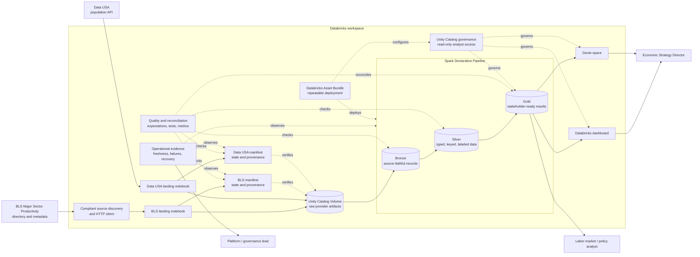
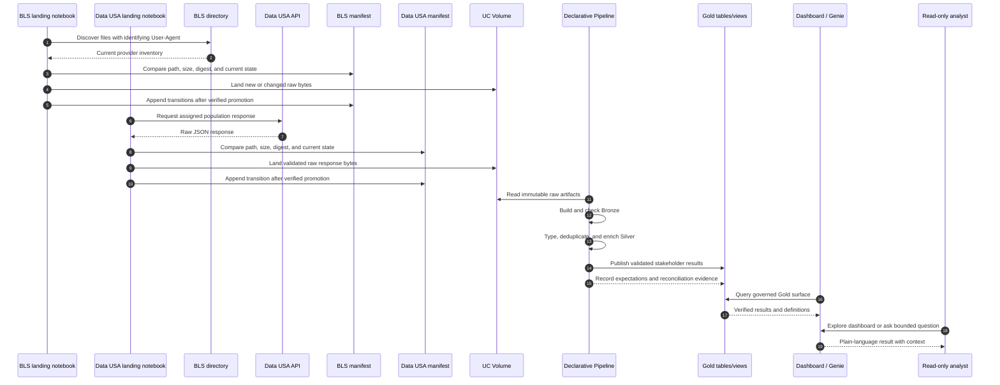

# UML-style system design

This document combines the implemented raw-ingestion boundary with the planned
Bronze, Silver, Gold, and stakeholder layers. Solid relationships are product
responsibilities; the landing notebooks and separate source manifests exist
today, while pipeline and presentation components remain planned. Dashed
relationships are validation, governance, or optional interactions.

## Component view

## Ingestion and publication sequence

## Responsibility boundaries

| Component | Responsible for | Not responsible for |
| --- | --- | --- |
| Discovery and ingestion | Policy-compliant requests, inventory, verified raw landing, rerun state | Interpreting economic meaning |
| Bronze | Source fidelity, provenance, initial structural expectations | Deduplicated stakeholder semantics |
| Silver | Types, keys, deduplication, metadata joins, readable labels | Final business presentation |
| Gold | Stable grains and verified analytical outputs | Raw-provider reconstruction |
| Dashboard and Genie | Accessible exploration of approved Gold results | Inventing causal explanations |
| Unity Catalog controls | Least-privilege access to intended objects | Proving analytical correctness |
| Quality and observability | Detecting incomplete, inconsistent, stale, or failed processing | Silently correcting provider data |
| Asset Bundle | Repeatable resource configuration and deployment | Replacing runtime validation |

