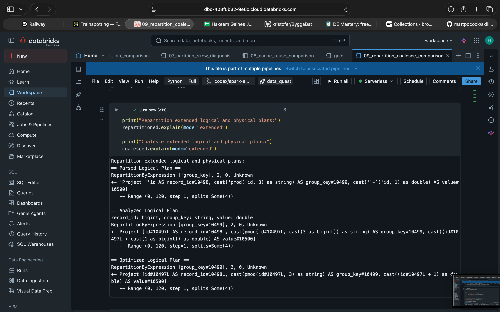
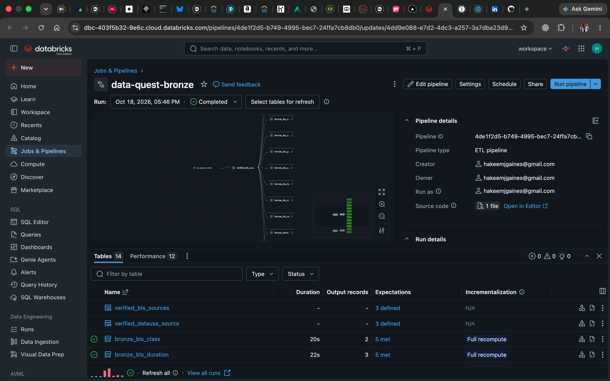
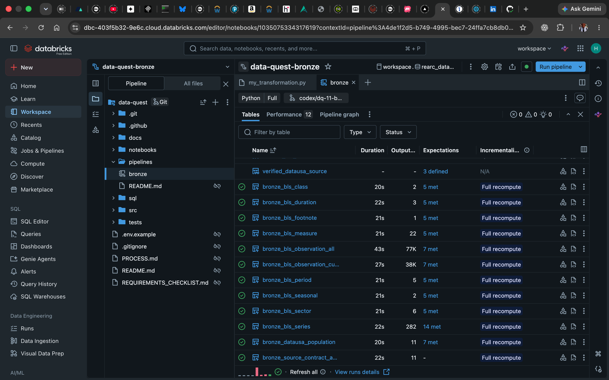

# Spark Internals: Data Quest Correction Walkthrough

## Status and evidence boundary

This is a post-submission portfolio extension. The controlled notebooks do not read or mutate the submitted assessment's landing, Bronze, Silver, Gold, manifest, or audit state. They use generated records to make Spark execution behavior visible in the same Databricks environment.

The original correction is documented in `PROCESS.md`. The live experiments illustrate the underlying mechanics; they do not recreate the exact production-shaped failure or claim benchmark results.

## The correction in one causal chain

The early Bronze verifier used a whole-file design. It decoded a complete source file, split the contents into an array, placed that array in one row, and then exploded it. That data shape concentrated a large amount of work and intermediate copying in one task. The observed failure was an executor `JVM_OUT_OF_MEMORY` condition in `UnsafeRow.copy`, not proof that the cluster lacked enough total memory.

The correction used a distributed line-oriented Spark reader. Individual records could be processed across partitions instead of first being assembled inside one oversized row. The immutable file-size, SHA-256, ordered-header, and provenance gates remained intact. The successful rerun completed with zero errors or warnings and produced approximately 77,000 AllData observations and 38,000 Current observations.

The engineering lesson is: memory pressure depends on task and partition shape, not only total cluster memory.

## Controlled experiment map

| Concept | Notebook | Observed evidence |
| --- | --- | --- |
| Narrow and wide transformations | `05_spark_groupby_baseline.py` | A filter stayed narrow; `groupBy` introduced a hash shuffle with partial and final aggregation. |
| Join strategy | `06_broadcast_join_comparison.py` | Ordinary and explicit broadcast paths returned identical results; the optimizer selected a broadcast hash join in both controlled plans. |
| Skew and salting | `07_partition_skew_diagnosis.py` | A balanced 30/30/30/30 distribution became 108/4/4/4 under a hot key; salting reduced the largest observed partition while preserving results. |
| Cache reuse | `08_cache_reuse_comparison.py` | The cached relation materialized 60 rows on disk-serialized storage. Single-run timings were recorded for inspection, not as a performance benchmark. |
| Repartition and coalesce | `09_repartition_coalesce_comparison.py` | `repartition(2, key)` created a hash shuffle and observed 40/80 occupancy; `coalesce(2)` avoided an exchange and observed 60/60. All paths preserved result parity. |

Environment observed on November 12, 2026: Databricks Free Edition serverless compute, Spark 4.2.0, and Photon where the operator was supported.

## Annotated physical plan

The group-by baseline provides the clearest compact plan:

1. `Range (... splits=4)` creates four input partitions for the controlled source.
2. `PhotonFilter` is a narrow transformation: each output record depends on one input partition.
3. `PhotonGroupingAgg` performs partial aggregation before data moves, reducing shuffle volume.
4. `PhotonShuffleExchangeSink hashpartitioning(series_id, 16)` redistributes equal keys so they can meet.
5. The final grouping aggregate merges partial counts and sums after the shuffle.
6. `AdaptiveSparkPlan isFinalPlan=false` shows that Adaptive Query Execution can still revise supported decisions using runtime statistics.

The repartition plan makes the data movement explicit:

The original corrected Bronze path is supported by the successful live validation evidence:

## Adaptive Query Execution: capability and boundary

Adaptive Query Execution (AQE) can use runtime statistics to revise supported physical decisions, coalesce post-shuffle partitions, change eligible join strategies, and mitigate some skewed joins. It remains an optimizer, not a substitute for sound data shape and contracts.

AQE cannot reliably split an opaque oversized row that the application has already constructed, repair incorrect source semantics, guarantee equal partition occupancy, eliminate every shuffle or memory failure, or replace schema and data-quality validation. That is why the whole-file design required an architectural correction instead of another configuration toggle.

## Evidence ledger

### Observed environment evidence

- The original run recorded an executor `JVM_OUT_OF_MEMORY` failure in `UnsafeRow.copy` after the whole-file array-row design concentrated work.
- The distributed line-oriented correction completed the affected Bronze validation without weakening its gates.
- The controlled notebooks exposed shuffles, broadcast joins, skew, salting, cache materialization, repartition, coalesce, AQE wrappers, and Photon support in the live environment.
- Assertions verified result parity for every comparison.

### General Spark guidance

- Filters and projections are normally narrow; aggregations and key-based repartitioning are normally wide because matching keys must be brought together.
- A broadcast join can avoid shuffling the large side when one input is safely small enough to distribute.
- Salting can spread a hot key but adds complexity and requires a correct merge step.
- Cache only data that will be reused enough to justify materialization and storage.
- Repartition usually shuffles to establish a new distribution; coalesce usually reduces partitions without a full redistribution.

### What this does not prove

- The small generated datasets are not performance benchmarks.
- One faster timing does not prove that cache, broadcast, repartition, or coalesce is universally faster.
- Requested partition counts do not guarantee equal record distribution.
- The controlled experiments explain execution mechanics; they do not reproduce the exact historical failure byte for byte.
- A successful plan does not prove that every future data volume or skew pattern is safe.

## 90-second practice answer

"The original failure was caused by data shape, not simply a lack of total cluster memory. My first Bronze verifier read an entire file, split it into an array inside one Spark row, and then exploded it. That concentrated the work and intermediate copies in one task, and the executor failed in `UnsafeRow.copy` with an out-of-memory condition.

I isolated the issue from the task behavior and the failing operation. I kept the important controls—file size, SHA-256, ordered headers, and provenance—but replaced the whole-file array-row design with distributed line-oriented reading. That let Spark process individual records across partitions. The corrected Bronze run completed with zero errors or warnings and produced the expected AllData and Current observation volumes.

I later built controlled notebooks to make the mechanics visible: narrow filters, wide group-by shuffles, broadcast joins, skew and salting, caching, repartition, coalesce, and AQE. The central lesson is that Spark reliability depends on how work is divided among tasks and partitions. More cluster memory would not necessarily fix one oversized task; the durable fix was changing the execution shape."

## Recall cue and follow-ups

Use this sequence rather than memorizing prose:

**Shape → Symptom → Isolation → Correction → Proof → Limit**

- **Why not add memory?** The overload was concentrated in one task; extra total memory does not guarantee that the task's unsafe shape becomes safe.
- **Why is `groupBy` wide?** Equal keys may begin in different partitions, so Spark must shuffle them together.
- **Why did broadcast help?** It made the small side available to workers and avoided redistributing the larger side in the controlled join.
- **What does AQE add?** Runtime-informed optimization of supported decisions, not automatic repair of an oversized application-created row.
- **When would you cache?** When a materialized intermediate will be reused enough to repay its computation and storage cost.
- **Repartition or coalesce?** Repartition when a deliberate redistribution is required; coalesce when reducing partitions without needing an even reshuffle.
